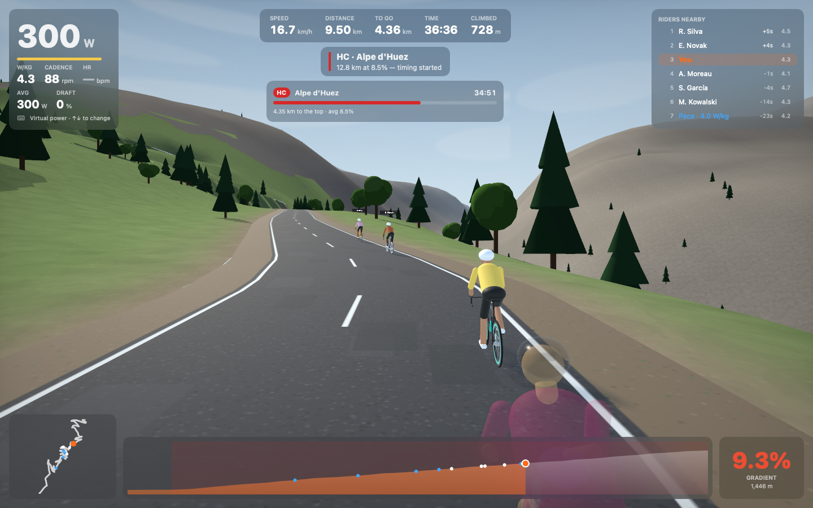
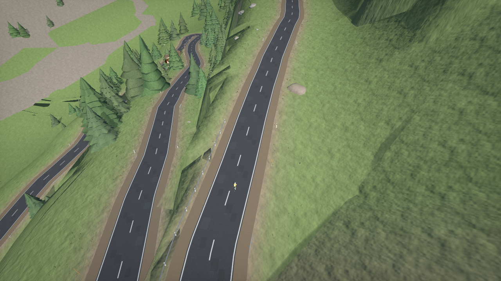
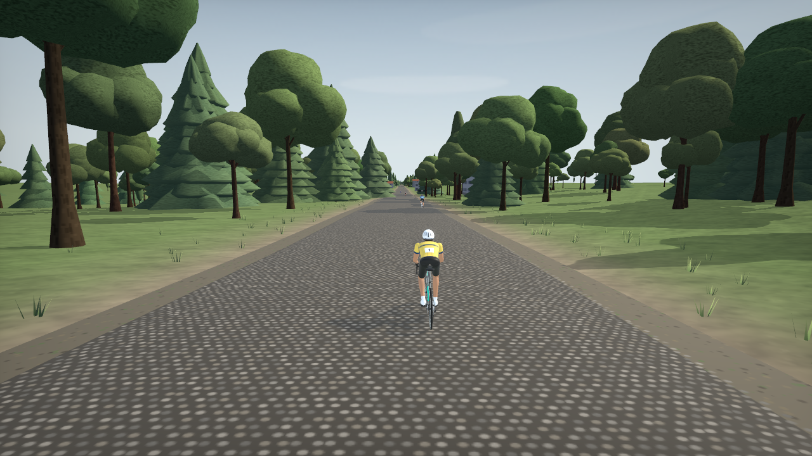

# Breakaway

A native macOS indoor-cycling simulator written in Swift. It uses SwiftUI, SceneKit and CoreBluetooth, and its routes are built from real map and elevation data.

Ride the Alpe d'Huez hairpins, the Stelvio, Mont Ventoux, the Zoncolan and the Angliru, plus the Arenberg cobbles, the Poggio and the Worlds circuits in Montréal and Zürich. All of them are traced over **real OpenStreetMap roads** with **real elevation models**, and the surrounding valleys and peaks come from the actual terrain.



| Stelvio hairpins (helicopter cam) | Trouée d'Arenberg cobbles |
|---|---|
|  |  |

*These screenshots come from the app's headless renderer (`Breakaway --snapshot <dir> [routes]`), which CI runs on every change.*

| | |
|---|---|
| **Routes** | 16 real routes: Grand Tour climbs, Monuments & Classics, UCI World Championship circuits. Plus any GPX you import. |
| **World** | 3D terrain from Copernicus EU-DEM / SRTM with cascaded shadows, roads cut into the hillside, layered spruce forests, broadleaf woods, stone pines, cypresses and palms, regional villages (chalets, Flemish brick, Mediterranean stucco, apartment blocks), crowds and camper vans on the climbs, guardrails, snow poles, KOM banners, French-style km markers, cobbled sectors, rippling lakes and sea. |
| **Bikes** | 7 frames (aero, climbing, TT, endurance, gravel, steel, track) and 6 wheelsets, built from real frame geometry (stack, reach, tube angles) with aerofoil tubes, toothed chainrings and cassettes, a chain, derailleurs, disc brakes, laced spokes and clear-coat paint. Each changes weight, CdA, rim "sail" and rolling resistance. |
| **Riders** | Anatomically lofted riders with kit panels, race numbers and vented helmets. Leg and arm IK with ankling; they switch between hoods, drops, descending tuck, out-of-the-saddle (the bike rocks) and TT extensions, and lean and steer through bends. |
| **Modes** | Free Ride, Group Ride (pace partners), Race (AI field), Time Trial (no draft), Workout (ERG). |
| **Trainers** | Bluetooth FTMS smart trainers (ERG and gradient simulation), Cycling Power meters, heart-rate straps and cadence sensors. |
| **Workouts** | 14 built-in sessions (FTP tests, sweet spot, VO₂, 30/30s, Tabata…). Import and export of Zwift `.zwo` files. |
| **Data** | FIT / GPX / TCX export (Strava, Garmin Connect, TrainingPeaks), power curve, NP/IF/TSS, time in zone, PBs per climb, XP and levels. |

## Build & run

Requirements: macOS 13 Ventura or later and Xcode 15+ (Swift 5.9+).

```bash
git clone <this repo> && cd Cycling-Challenge-Claude
scripts/build-app.sh          # → build/Breakaway.app (ad-hoc signed)
open build/Breakaway.app
```

You can also open `Package.swift` in Xcode and run the **Breakaway** scheme, or use `swift run Breakaway`. Info.plist is embedded in the binary, so the Bluetooth permission prompt works however you launch it.

Each CI run on GitHub Actions also uploads a ready-built `Breakaway-macOS.zip` as an artifact.

## Riding

1. **Devices**: press *Scan* with the trainer awake, then assign each sensor a role (trainer, power meter, HR, cadence). Pairings reconnect automatically.
2. **Ride**: pick a route, a mode and the number of laps or AI riders, then press *Start*.
3. No trainer? Virtual power is on by default. Use **↑ / ↓** to change watts (hold **⇧** for ±50 W).

| Key | Action |
|---|---|
| `1`–`7` | Cameras: chase, close, rider's eye, side, front, helicopter, cinematic |
| `Space` / `Esc` | Pause (end and save, or discard, from the pause menu) |
| `E` | ERG on/off in workouts |
| `[` `]` | Trainer difficulty −/+ 10 % (like Zwift, 50 % by default) |
| `H` | Hide or show the HUD |

## Routes and how they were made

Every bundled route is generated by `tools/routegen/build_routes.py`:

1. Waypoints are routed over OpenStreetMap roads with OSRM. Out-and-back detours are detected and cut.
2. The road is sampled every 30 m against **Copernicus EU-DEM 25 m** (Europe) or **NASA SRTM 30 m**. The result is smoothed (with a monotone fit for the mountain climbs), and gradients are clamped to each climb's published maximum, because DEMs blur hairpins.
3. A DEM grid around the route gives the 3D world its real mountains, valleys and water.
4. Each route is validated against race-book figures. The full table is in [`docs/ROUTES.md`](docs/ROUTES.md).

| Route | Built | Official |
|---|---|---|
| Alpe d'Huez | 13.83 km, +1,088 m | 13.8 km, +1,071 m |
| Mont Ventoux (Bédoin) | 21.54 km, +1,577 m | 21.8 km, +1,617 m |
| Col du Tourmalet (Luz) | 19.09 km, +1,406 m | 19.0 km, +1,404 m |
| Passo dello Stelvio | 25.53 km, +1,849 m | 24.3 km, +1,808 m |
| Alto de l'Angliru | 12.47 km, +1,245 m | 12.5 km, +1,266 m |

The km-by-km gradients follow the real climbs too. Ventoux, for example, has its gentle 3–6 % start out of Bédoin, the 9–11 % forest and the easier section past Chalet Reynard. Angliru has a moderate first half, the 2.5 % respite, then 12–15 % to the summit. Grand Tour climbs are fitted monotonically (DEM noise can't fake a descent), and the 3D terrain is anchored to the surveyed road, so hairpin stacks sit on a real mountainside.

Each route carries a data-quality badge:
- **Verified**: within 6 % of the official distance.
- **Traced**: real roads, but no official figure to compare against.
- **Approximate**: the named roads are right, but the exact street sequence of the circuit couldn't be confirmed. This applies to Montréal 2026, Zürich 2024, Mortirolo and Ghisallo.

For a perfect copy of any course, import the organiser's official GPX (*Ride ▸ Import GPX Route…*).

## Physics

The ride model is Martin et al. (1998) extended with the effects that matter on real roads:

| Effect | Model |
|---|---|
| Air drag | ½·ρ·CdA(β)·Vₐ·(v + w_h)·(1 − draft). Drag area grows with yaw angle; deep rims "sail" in a crosswind |
| Wind | Mean wind + gusts (Ornstein–Uhlenbeck), sheltered by forests and towns, split into head and cross components on every bend. Pick *Still air*, *Typical breeze* or *Windy* on ride setup |
| Air density | Altitude (ISA), temperature lapse with height, humidity |
| Rolling | Crr by surface and tyre, rising with speed (tyre hysteresis; vibration losses on pavé and gravel) plus wheel-bearing friction |
| Inertia | Wheel moment of inertia from rim depth and weight |
| Riding position | Hoods, drops (−8 % drag), tuck (−20 %), standing (+10 %), TT position — chosen automatically from gradient, speed and effort |
| Drafting | Wind-tunnel/CFD-based shelter; in a crosswind the wake drifts downwind so **echelons** form; a small push for the rider being followed |
| Cornering | Safe speed v = √(μ·g·r) from the road's curvature with braking distance; riders brake for hairpins and city corners and lean at atan(v²/(g·r)) |
| Drivetrain | Real chainrings and cassettes per frame: cadence from gear and speed, chain efficiency per sprocket |
| Physiology | W′ balance (Skiba): AI attacks burn matches and fizzle when they run out; your W′ is on the HUD |
| Pack | AI riders can't ride through each other; they swing out to pass |

Smart trainers in SIM mode receive the gradient plus the real headwind, rolling resistance and drag coefficient for the current position and shelter.

## Architecture

```
Sources/BreakawayCore   Platform-independent engine (builds and tests on Linux)
  Physics/              Martin et al. power model + yaw aero, wind, cornering, W′, gearing, drafting/echelons
  Models/               Procedural 3D models (bikes, riders + pose solver, trees, houses, crowds) — testable on Linux
  Routes/               Route model, climb detection + FIETS categories, generated catalogue
  World/TerrainModel    DEM bicubic + fractal detail + road cut/fill blending
  Session/              RideSimulation (player + AI riders, laps, KOMs, ERG/SIM targets), metrics
  Devices/              FTMS / CPS / HRS / CSC GATT parsing and control-point encoding
  Workouts/             Workout model, library, .zwo import/export
  Export/               FIT encoder, GPX/TCX export, GPX import
Sources/Breakaway       macOS app: SwiftUI UI, SceneKit world, CoreBluetooth devices
Tests/                  70+ XCTest cases: physics, models and poses, protocols, routes, simulation, exports
tools/routegen          Route data pipeline (OSM + DEM → Swift)
```

Run the engine tests anywhere Swift runs: `swift test`.

## Honest limitations

- **No online multiplayer.** Other riders are physics-simulated AI (pace partners and a race field matched to your FTP), not real people.
- **No licensed brand bikes.** The frames and wheels are generic archetypes with realistic physics. Real brand models would need trademark licences.
- Graphics are fully procedural (no art team or scanned assets): detailed, but stylised rather than photoreal.
- Some city circuits are approximate (see above). The mountain climbs match their race-book figures.

## Attribution

Road geometry © [OpenStreetMap](https://www.openstreetmap.org/copyright) contributors, ODbL 1.0. Routing by OSRM. Elevation from Copernicus EU-DEM v1.1 and NASA SRTM via OpenTopoData. Breakaway is not affiliated with Zwift, the UCI, or any race organiser.
